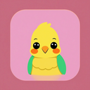
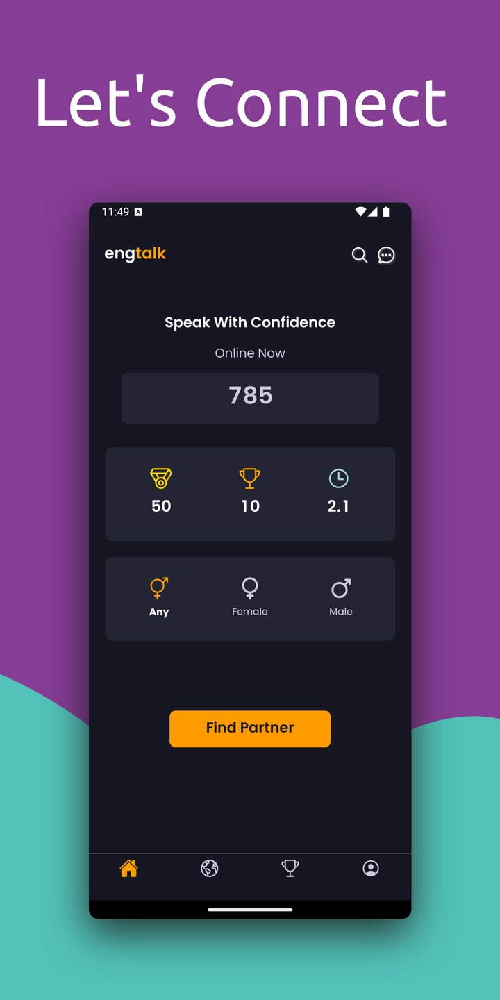
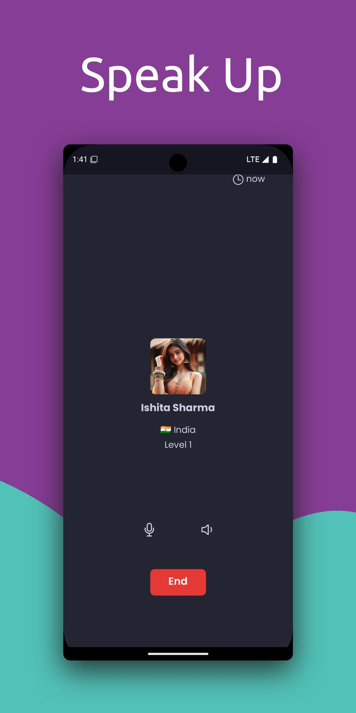
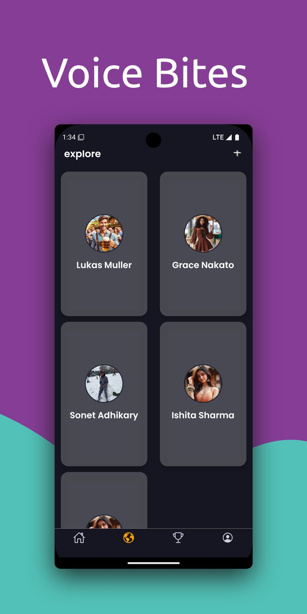
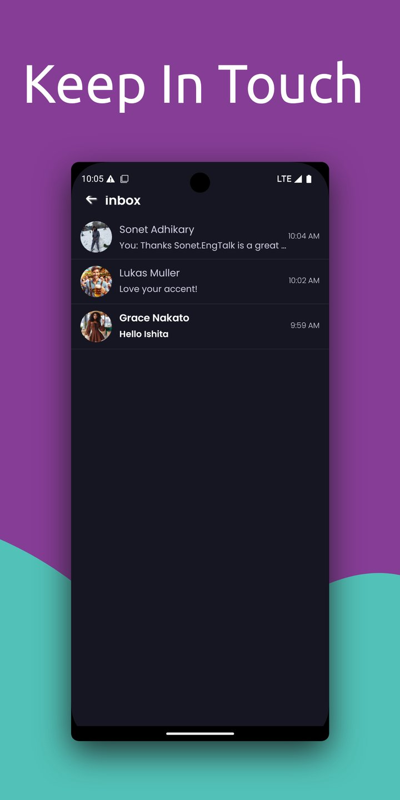
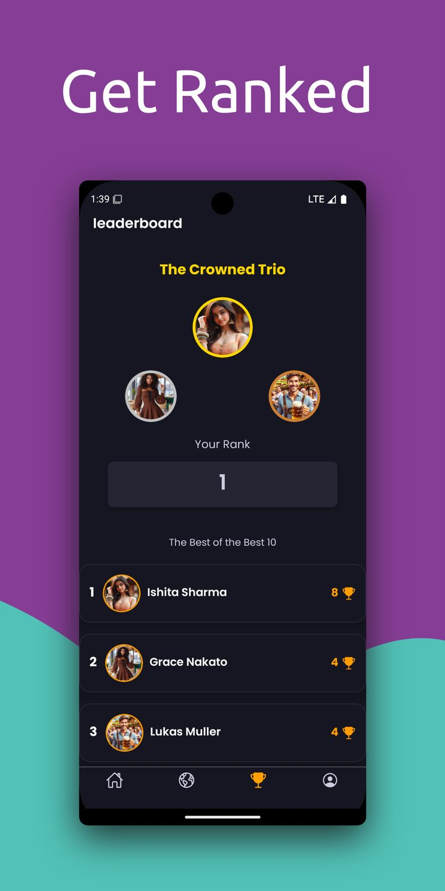
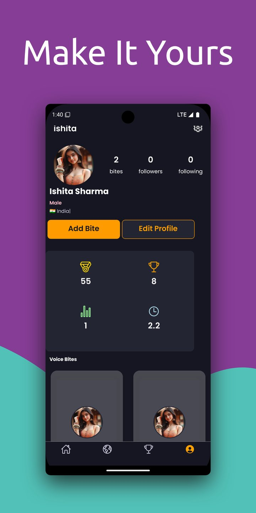
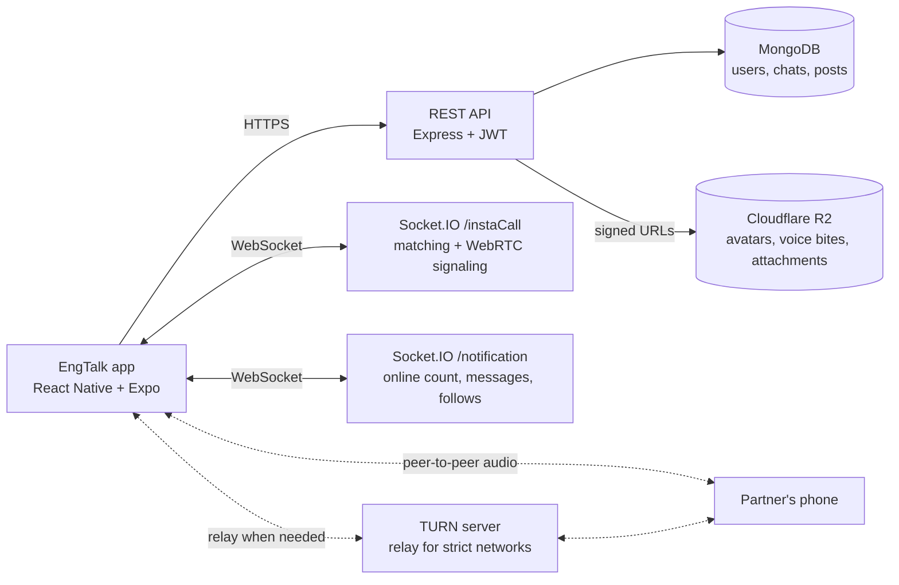

# EngTalk

A React Native app for practicing spoken English with real people. Tap once, get matched with another learner, and talk over a live voice call. I designed and hand-coded the whole app, plus the Node.js backend behind it.

**Live on Google Play, 500+ downloads:** https://play.google.com/store/apps/details?id=com.sonetadhikary.engtalk

| | | |
|:---:|:---:|:---:|
| <br/>Find a partner | <br/>Live voice call | <br/>Voice Bites |
| <br/>Chat inbox | <br/>Leaderboard | <br/>Profile and stats |

## What it does

- **Find a speaking partner:** one-tap matching with another learner who is online, with an optional gender filter
- **Live voice calls:** peer-to-peer audio over WebRTC, with a TURN server for users behind strict networks
- **Chat and inbox:** real-time messages through Socket.IO, with conversation history
- **Voice Bites:** record and share short voice clips on your profile
- **Social layer:** follow other learners, see who is online, view profiles and stats
- **Leaderboard and coins:** a ranking of top speakers plus gold and silver coins, with silver coins convertible in the app

## Tech stack

| Area | What I used |
|---|---|
| App | React Native, Expo (SDK with dev client), TypeScript |
| Navigation | Expo Router (file-based), bottom tabs and top tabs |
| Real-time | react-native-webrtc for calls, Socket.IO for signaling and chat |
| State and storage | Zustand with the slices pattern and Immer, MMKV for fast local storage |
| UI and performance | FlashList for long lists, Reanimated, Gesture Handler, Bottom Sheet |
| Media | expo-av for recording and playback, image picker with compression |
| Release | EAS Build, EAS Submit, OTA updates with expo-updates, in-app update prompts |
| Revenue | Google AdMob native ads |
| Backend (private repo) | Node.js, Express, a REST API plus WebSocket server, Cloudflare R2 for media |

## How the code is organized

```
app/              Screens, using Expo Router file-based routes
  (auth)/         Sign in and sign up
  (tabs)/         Home, explore, follow, profile and leaderboard tabs
  Call.tsx        The live voice call screen
  Chat.tsx        One-to-one chat
components/       57 reusable UI components
store/features/   Zustand slices, one per feature (auth, call, inbox, voice bites...)
libs/api/         Typed API calls to the backend
hooks/            Shared hooks
config.ts         Backend endpoints
```

## Architecture

The backend lives in a separate private repository because it runs the live app. It is a Node.js and Express server with MongoDB, two Socket.IO namespaces, a TURN server and Cloudflare R2 for media.



**REST API** (Express, Mongoose, express-validator)
- `/user`: sign up, sign in, profile updates, follow, search, leaderboard
- `/message`: inbox, conversations, attachments
- `/post`: Voice Bites feed and uploads
- `/stat`: speaking stats and gold and silver coins
- `/iceserver`: short-lived TURN credentials for the signed-in user

**How a call works**
1. The app joins the `/instaCall` namespace and asks for a match, with an optional gender preference.
2. The server pairs two waiting users and sends `matchFound` to both.
3. Both phones exchange WebRTC offers, answers and ICE candidates through the socket.
4. Audio flows directly between the two phones. If a direct path fails, it relays through the TURN server.

**Decisions worth noting**
- **TURN credentials are never stored in the app.** The backend signs a username with an HMAC secret and hands out credentials that expire in 24 hours, the standard TURN REST API pattern.
- **Media files are private.** Uploads go to Cloudflare R2 and are served through signed URLs that expire, so no bucket is public. I chose R2 because it has no egress fees, which matters for an app full of audio.
- **Uploads are checked before they reach storage.** Multer keeps files in memory with size limits and a type filter, then the server writes them to R2.
- **Every protected route goes through one JWT auth guard,** and sign-up, sign-in, profile, message and post input is validated with express-validator before it reaches a handler.

Backend code is available on request.

## Run it locally

```bash
npm install
npx expo run:android   # WebRTC needs a development build, not Expo Go
```

The app points to the hosted backend in `config.ts`. The backend itself is a separate private repository.

## About me

I'm Sonet, a senior React Native developer. I build iOS and Android apps with Next.js dashboards and AI features, and I take over stuck apps and get them shipped.

LinkedIn: https://www.linkedin.com/in/sonetad
